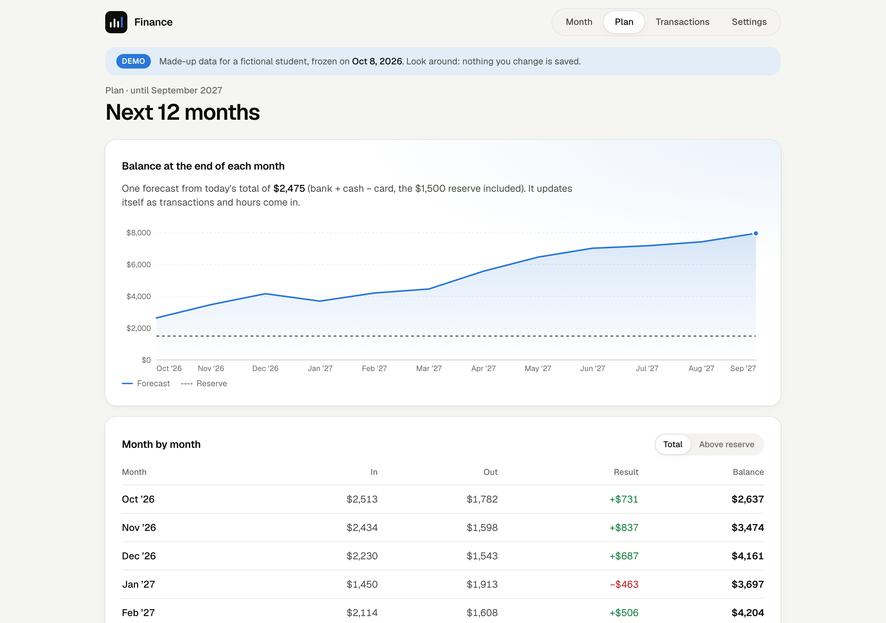
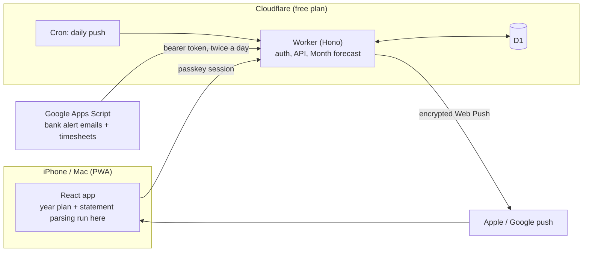

# Finance

A personal cash-flow app that answers one question every morning: **how much can I spend today without touching my reserve or next month's bills?**

**[Live demo →](https://demo.ricardogross.com)** (made-up data, read-only) · [Security write-up](SECURITY.md) · [Deploy guide](DEPLOY.md)


## Why

I work two hourly jobs while studying. My paychecks change with my hours, rent and the card bill land on fixed days, and a balance in a bank app says nothing about next Tuesday. Budgeting apps either need my bank password or only look backwards.

So I built the forecast I wanted: it knows the hours I logged, when each job pays, every bill and budget, and the reserve I never want to dip into. From that it works out, day by day, the lowest point my balance will reach, and what is left above the reserve on that day is safe to spend.

## What it does

- **Month:** safe to spend, a day-by-day forecast to the end of next month (paydays, the tightest day, the reserve), balances, money in and out, budgets that fill as you spend, bills paid or due, and whether next month is covered.
- **Plan:** a rolling 12-month forecast, savings goals filled in priority order, room to spend on each trip, and the assumptions behind it, written from the plan itself.
- **Transactions:** imports Chase statement PDFs and Chase / Discover CSVs in the browser, categorizes them with rules you can grow, and adds cash by hand.
- **Settings:** balances, jobs and hours, time away, budgets, bills, one-offs, rules, notifications and a security screen with devices, passkeys and an activity log.
- **Stays current by itself:** bank alert emails and timesheets arrive twice a day through a Google Apps Script, and a push notification at 8 am says what is safe to spend.

<table>
  <tr>
    <td></td>
    <td></td>
    <td></td>
    <td></td>
    <td></td>
  </tr>
</table>



## How it works



- **One forecast, no guessing games.** Hours become paychecks through pay-period rules (day of month rolled to a business day, or the n-th business day). After the last logged day, each job counts the average of its recent full weeks, capped so extra hours stay extra. Bills, budgets spread per day, one-offs, trips and job closures go on the same timeline; the lowest point above the reserve is safe to spend.
- **This month is honest.** Budgets for the rest of the month count only what is left of each one; bills already due but not seen yet move to tomorrow so nothing is forgotten.
- **Live balances** are the last balance you checked plus every entry after it, with checking counted by transaction date and the card by posting date.
- **Bank alerts** are parsed from email only when Gmail's DMARC check passes for the bank's exact domain; statements imported later replace the alert entries.
- **Built for 10 ms of CPU.** The Workers free plan allows about 10 ms per request, so the Worker computes only the Month screen (~1 ms). The 12-month plan and PDF parsing run in the browser.

## Engineering notes

- **Domain engine in plain TypeScript** (`shared/`), shared by the Worker, the app and the scripts, with no I/O. Every pay-schedule and projection rule has a fixture test.
- **Web Push from scratch** on WebCrypto: VAPID (RFC 8292) and aes128gcm payload encryption (RFC 8291), no library.
- **Passkey-only sign-in** with signed, stateless challenges, so unauthenticated requests write nothing to the database.
- **Public demo from the same code:** a Wrangler environment with its own database, a frozen "today", every write refused on the server, and a deterministic data generator (`scripts/demo.ts`).
- **Versioned plan format** with migrations on read, so older saved plans keep working.
- **114 tests** (Vitest), strict types across four TypeScript projects, oxlint.

## Security

Passkeys only, `__Host-` session cookies, CSRF header, zod validation on every body, body size limits, rate limits, a strict CSP, TLS 1.2+, an allowlist for push hosts, and a security log. Two review rounds (automated scans, manual review, Trail of Bits sharp edges, an OWASP Top 10 pass) are written up with the threat model in [SECURITY.md](SECURITY.md).

## Run it locally

```bash
npm install
node scripts/demo.ts        # tables + made-up data in a local demo database
CLOUDFLARE_ENV=demo npx vite --port 5174
```

With your own data instead: put statements in `data/imports`, then `npm run db:migrate`, `npm run import`, `npm run seed`, `node scripts/secrets.ts` and `npm run dev`. `.dev.vars` (gitignored) holds local secrets; `DEV_AUTH_BYPASS=1` skips sign-in on localhost only.

```bash
npm test && npm run typecheck && npm run lint
```

Deploying your own copy: [DEPLOY.md](DEPLOY.md). Email and timesheet sync: [apps-script/README.md](apps-script/README.md).

## Stack

React 19, Vite 8, Tailwind 4 · Cloudflare Workers, D1, Cron Triggers, Wrangler 4 · Hono, Zod · SimpleWebAuthn · unpdf (browser only) · Google Apps Script · Vitest, oxlint.

## Privacy

No real financial data is in this repository: statements, balances and plans live in the gitignored `data/` folder and the deployed database. The app never moves money and never sees a bank password; the Apps Script reads Gmail read-only and only looks at Chase and Discover emails.
