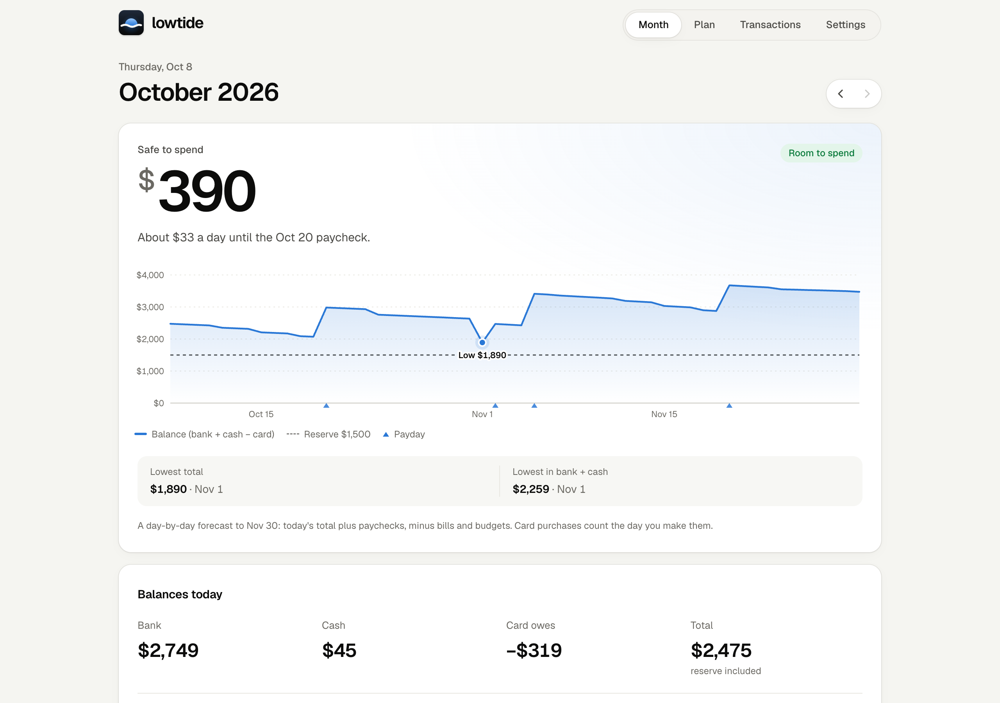
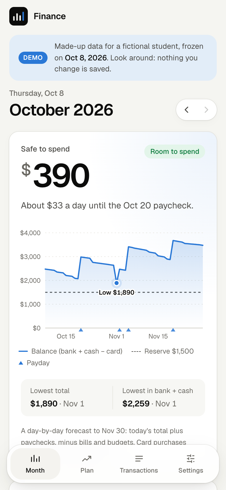
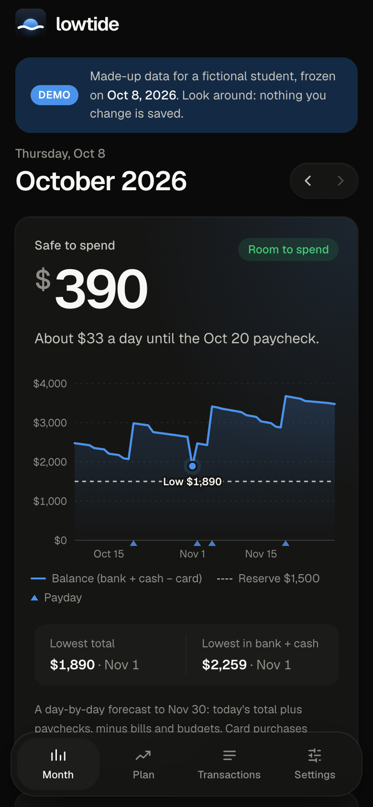
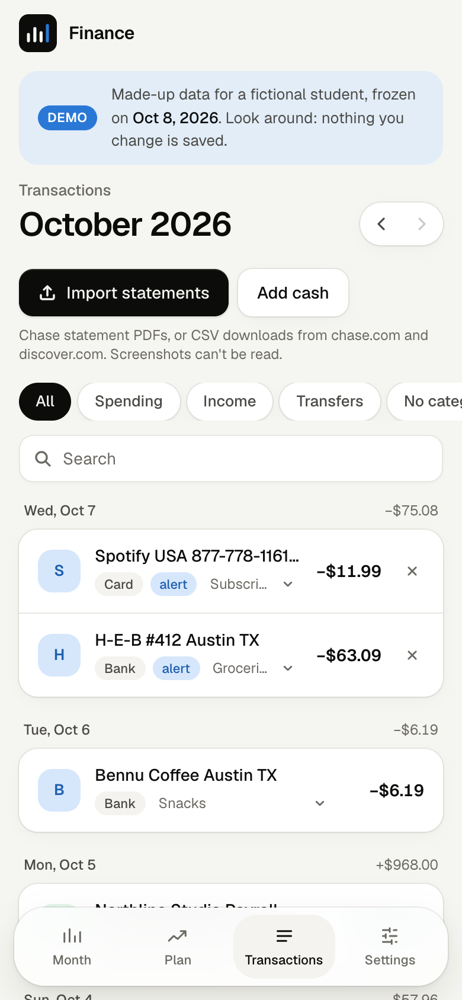
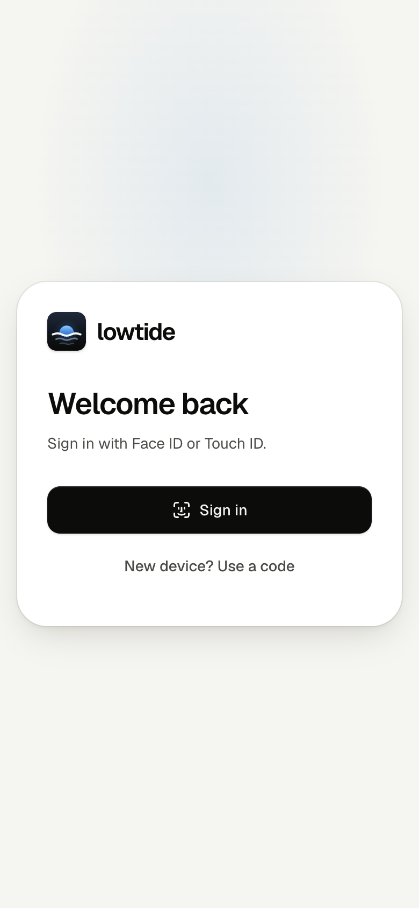
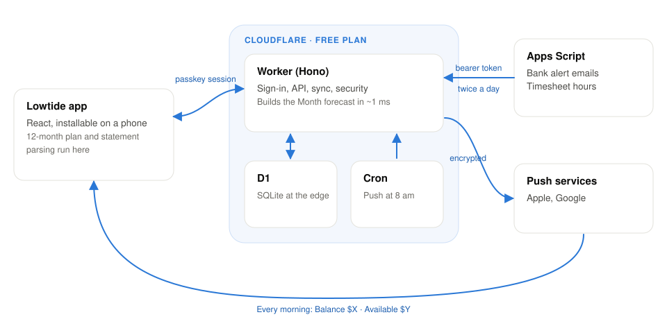

<p align="center">
  <picture>
    <source media="(prefers-color-scheme: dark)" srcset="docs/brand/lowtide-lockup-dark.svg" />
    
  </picture>
</p>

<h3 align="center">Know what's safe to spend.</h3>

<p align="center">
  A day-by-day forecast of your balance, built for paychecks that change.
  <br />
  <a href="https://lowtide.ricardogross.com"><b>Website</b></a> ·
  <a href="https://demo.ricardogross.com"><b>Live demo</b></a> ·
  <a href="docs/architecture.md">Architecture</a> ·
  <a href="SECURITY.md">Security</a>
</p>

<p align="center">
  <a href="https://github.com/ricardoogross/lowtide/actions/workflows/ci.yml"></a>
  
  
  <a href="LICENSE"></a>
</p>

<picture>
  <source media="(prefers-color-scheme: dark)" srcset="docs/screenshots/month-desktop-dark.png" />
  
</picture>

## Why

Your balance has tides. Paychecks lift it; rent, bills and the card pull it down. A bank app shows today's water level and nothing about next Tuesday, when rent and the card bill land two days before payday.

I work two hourly jobs while studying, so my pay changes with my hours, and budgeting apps either wanted my bank password or only looked backwards. Lowtide is the forecast I wanted: it knows the hours I logged, when each job pays, every bill and budget, and the reserve I never want to dip into. From that it works out the lowest point my balance will reach before the next paycheck, and what is above the reserve on that day is **safe to spend**.

## What it does

- **Month:** safe to spend (and how much that is per day), a day-by-day forecast to the end of next month with paydays, the low point and the reserve, today's balances, budgets that fill as you spend, bills paid or due, whether next month is covered job by job, and the next 14 days.
- **Plan:** a rolling 12-month forecast, savings goals filled in priority order, room to spend on each trip without breaking the reserve, and the assumptions behind it, written from the plan itself.
- **Transactions:** Chase statement PDFs and Chase / Discover CSVs import right in the browser; categories learn from rules you create in one tap; cash entries by hand.
- **Settings:** balances, jobs and hours, time away, budgets and bills, one-offs, rules, the daily notification, and a security screen with devices, passkeys and an activity log.
- **Runs by itself:** a Google Apps Script forwards bank alert emails and timesheet hours twice a day, and a push notification at 8 am says what is safe to spend.

<table>
  <tr>
    <td></td>
    <td></td>
    <td></td>
    <td></td>
    <td></td>
  </tr>
</table>

## How it works

<picture>
  <source media="(prefers-color-scheme: dark)" srcset="docs/architecture-dark.svg" />
  
</picture>

1. **Hours become paychecks.** Each job has pay periods and pay-date rules (a day of the month rolled to a business day, or the n-th business day). After the last logged day, a job counts the average of its recent full weeks, capped so extra hours stay extra.
2. **Everything goes on one timeline.** Bills, budgets spread per day, one-offs, trips and job breaks sit next to the paychecks. For the current month, budgets count only what is left of them, and bills that are due but not seen yet move to tomorrow.
3. **The low tide sets the number.** The balance is projected day by day from today's live total (the last balance you checked plus every entry since). Safe to spend is the lowest projected balance before the horizon, minus the reserve.

The full design, data model, API and the decisions behind them: [docs/architecture.md](docs/architecture.md).

## Engineering notes

- **A domain engine in plain TypeScript** (`shared/`), with no I/O, shared by the Worker, the app and the CLI scripts. Every pay schedule and projection rule has a fixture test.
- **Built for 10 ms of CPU.** The Workers free plan allows about 10 ms per request, so the Worker computes only the Month screen (~1 ms); the 12-month plan and PDF parsing run in the browser.
- **Web Push from the RFCs** on WebCrypto: VAPID (RFC 8292) and aes128gcm payload encryption (RFC 8291), no library.
- **Passkey-only sign-in** with signed, stateless challenges, so an unauthenticated request never writes to the database.
- **Bank emails are verified, not trusted.** An alert only counts when Gmail's DMARC result passes for the bank's exact domain, and the bank's own statement rows replace alert entries when they arrive.
- **A versioned plan format** with migrations on read, so plans saved by older versions keep working.
- **A public demo from the same code:** its own Wrangler environment and database, a frozen "today", every write refused on the server, and a deterministic generator for six months of made-up data.

## Security and privacy

There are no bank credentials anywhere: data comes from alert emails, files you import and numbers you type, and the app never moves money. Sign-in is passkeys only, sessions live in `__Host-` cookies, every body is validated, and the API sets strict headers and rate limits. No real financial data is in this repository. The threat model, every control and three review rounds (automated scans and live probing, a Trail of Bits sharp-edges review with an OWASP Top 10 pass, and an audit before publishing) are written up in [SECURITY.md](SECURITY.md).

## Try it locally

You need Node 22.18 or newer (for TypeScript type stripping).

```bash
git clone https://github.com/ricardoogross/lowtide.git && cd lowtide
npm install
node scripts/demo.ts                       # a local database with made-up data
CLOUDFLARE_ENV=demo npx vite --port 5174   # then open http://localhost:5174
```

To run it with your own data and deploy your own copy (Cloudflare free plan, about 15 minutes): [DEPLOY.md](DEPLOY.md). Email and timesheet sync: [apps-script/README.md](apps-script/README.md).

```bash
npm test            # Vitest
npm run typecheck   # tsc -b across the app, Worker, scripts and config
npm run lint        # oxlint
```

## Project layout

```
src/          React app: pages, components, the API client
worker/       Cloudflare Worker: Hono routes for auth, API, sync and security; D1; the daily push
shared/       Pure TypeScript used by the app, the Worker and the scripts
  engine/       dates, holidays, pay schedules, cash flows, projection
  plan/         the plan format and its migrations, forecasts, the Month and 12-month views
  import/       statement PDF and CSV parsers, bank alert emails, categorizer, ledger
  push/         Web Push (VAPID + aes128gcm) on WebCrypto
  brand/        the Lowtide mark, drawn once for the app, icons and docs
apps-script/  Google Apps Script that forwards bank alerts and timesheet hours
migrations/   D1 schema
scripts/      seed, import, demo data, secrets, device codes, brand assets, screenshots
site/         the landing page (static, deployed on its own)
test/         Vitest suites for the engine, plan, import, push and the Apps Script
docs/         architecture, brand guide, screenshots
```

## Roadmap

- [x] Forecast engine, statement and CSV import, bank alert emails, timesheet hours
- [x] Passkey sign-in, security screen, daily push, installable web app
- [x] Public demo and landing page
- [ ] Accounts for everyone: per-user data, sign-up, invites for a shared household
- [ ] More banks' alert emails and statement formats
- [ ] Optional bank connections through an aggregator, next to the email route
- [ ] More timesheet sources than Google Sheets

## Built with

React 19 · Vite 8 · Tailwind 4 · TypeScript · Cloudflare Workers, D1 and Cron Triggers · Hono · Zod · SimpleWebAuthn · unpdf · Google Apps Script · Vitest · oxlint

## License

[MIT](LICENSE) © 2026 Ricardo Gross. The Geist font is under the SIL Open Font License.
