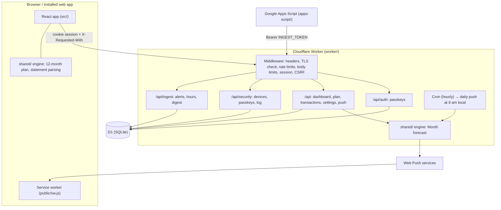
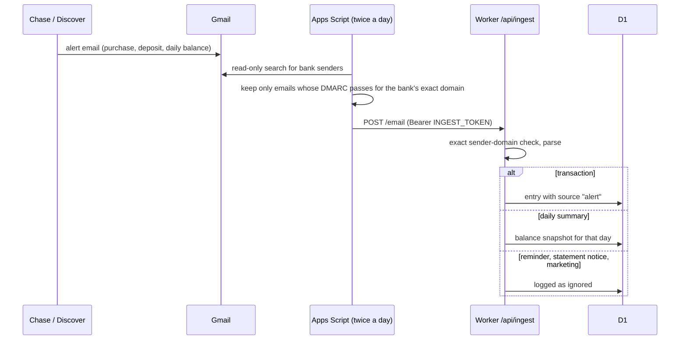
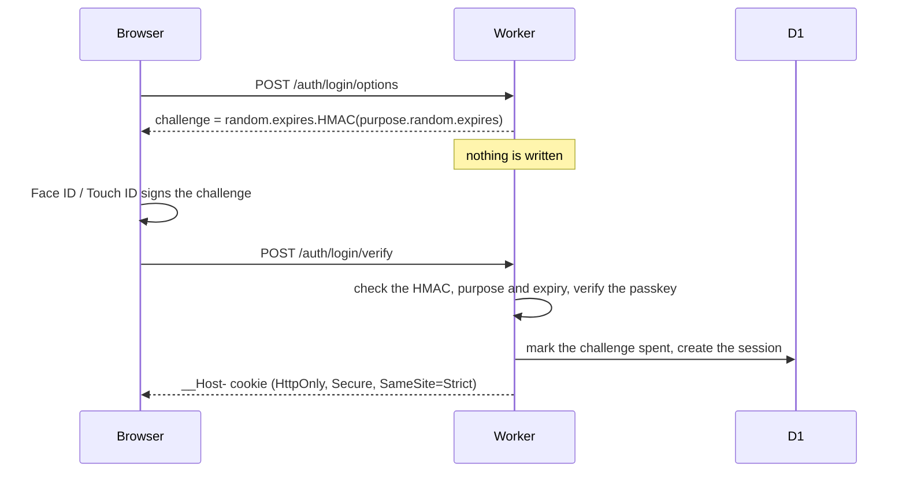

# Architecture

How Lowtide turns paychecks, bills and plans into one number, and how the pieces fit together. For the security model, see [SECURITY.md](../SECURITY.md); for running your own copy, [DEPLOY.md](../DEPLOY.md).

- [System overview](#system-overview)
- [The forecast](#the-forecast)
- [Data coming in](#data-coming-in)
- [Data model](#data-model)
- [API](#api)
- [Sign-in and sessions](#sign-in-and-sessions)
- [The daily notification](#the-daily-notification)
- [The public demo](#the-public-demo)
- [Performance budget](#performance-budget)
- [Testing](#testing)
- [Decisions and trade-offs](#decisions-and-trade-offs)

## System overview

There is one Worker and one database. The React app is served as static assets by the same Worker; requests under `/api/*` always reach the Worker first (`run_worker_first`). The forecasting code lives in `shared/` as pure TypeScript with no I/O, so the same functions run in the Worker, in the browser and in the CLI scripts, and the tests exercise them directly.

| Folder | What lives there |
|---|---|
| `shared/engine` | Dates (UTC math on ISO strings), US federal holidays, pay schedules, cash flows, the daily projection |
| `shared/plan` | The plan format (version 2) and its migrations, hours learning, the forward forecast, the Month and 12-month views, the push message |
| `shared/import` | Chase statement PDFs, Chase and Discover CSVs, bank alert emails, the categorizer and the ledger merge |
| `shared/push` | Web Push: VAPID JWTs (RFC 8292) and aes128gcm encryption (RFC 8291 / 8188) on WebCrypto |
| `worker/` | Hono routes, D1 access, sessions and passkeys, the scheduled push |
| `src/` | React 19 screens, Tailwind 4 styles, the API client |

## The forecast

Everything the forecast needs is in the **plan** (`PlanConfig`, `shared/plan/config.ts`) and the **actuals** (live balances and what already happened this month).

### Inputs

| Plan field | Meaning |
|---|---|
| `reserve` | Money never counted as available, from a start date on |
| `jobs` | Pay rates (with dates), pay periods and pay-date rules, usual and maximum weekly hours, work days, holidays off, closures |
| `away` | Time away (no job pays); trips also cut home budgets to a quarter |
| `bills` | Fixed amounts on a day of the month (or the n-th business day), paid from the bank, the card or cash, with skipped months |
| `budgets` | Day-to-day spending per category, spread evenly over the days of the month |
| `events` | One-offs (or yearly): tuition, gifts, a trip |
| `goals` | Savings targets, filled in list order after the reserve |

### From hours to paychecks

A job's hours come from three sources, in order:

1. **Logged days** from the timesheets count as they are.
2. **After the last logged day**, the job counts the average of its last full Monday-to-Sunday weeks since `hoursSince`, leaving out weeks with time away, closures or holidays, and capped at `maxWeeklyHours`, so a week of overtime never inflates the forecast (`weeklyHoursBasis`, `shared/plan/hours.ts`).
3. **Until two full weeks are logged**, it counts the usual `weeklyHours`.

Hours are then grouped into pay periods (for example the 1st to the 15th, paid on the 20th) and paid on the period's pay date, rolled to a business day when needed (`paycheckFlows`, `shared/engine/schedule.ts`).

### The timeline

`planFlows` (`shared/plan/forecast.ts`) puts every paycheck, bill, budget and one-off between two dates on one list of dated cash flows. `forwardFlows` (`shared/plan/forward.ts`) adjusts it for what already happened:

- For the rest of the current month, each budget counts only what is left of it (the budget minus what was already spent in that category), spread over the remaining days.
- A bill that was due on or before today but is not in the books yet moves to tomorrow, so it is never forgotten.
- Paychecks and one-offs dated today or earlier are left out: they are either in the books already or did not happen.

### Live balances

Today's balances are the last balance typed in (or read from a bank's daily summary email) plus every entry after it (`computeActuals`). Checking and cash balances are *available* balances, so their entries count by transaction date; the card balance is the *posted* balance, so card entries count by posting date. On the balance's own day, an entry counts only when both have a time and the entry is later.

There are two views of the same money: the **total** (bank + cash − card), where a card purchase counts the day it is made, and the **cash** view, where the card bill leaves the bank on its due date. The total drives the forecast; the cash view answers "will the bank account go negative?".

### Safe to spend

The balance is projected day by day from today's total to the **horizon**: the end of next month, or January 31 when today is in November (so the holidays never fall off the edge). Then:

> **Safe to spend = the lowest projected balance before the horizon − the reserve.**

The reserve only counts from its start date. If the lowest point is below the reserve, safe to spend is $0 and the app says to stick to essentials until the next paycheck.

**A worked example, from the demo** (Oct 8, 2026): bank $2,749 + cash $45 − card $319 = **$2,475**. Rent ($725 on Nov 1) and the October bills pull the projection down to **$1,890 on Nov 1**, before the November paychecks lift it again. With a $1,500 reserve, safe to spend is $1,890 − $1,500 = **$390**, about $33 a day until the Oct 20 paycheck.

### Twelve months ahead

`buildYearPlan` (`shared/plan/year.ts`) runs the same flows for the next 12 months (it rolls forward, so it never runs out) and adds:

- the balance at each month's end, in total or above the reserve;
- **goals filled in order:** each goal counts only what is left above the reserve once the goals before it are complete, and the app shows the extra saving a month that would close any gap;
- **room on each trip:** the most you can spend from a trip's first day and still keep the reserve until the month after it;
- **assumptions written from the plan**, so the forecast explains itself in plain words.

This runs in the browser, not the Worker (see [Performance budget](#performance-budget)).

### The plan format

The plan is stored as one JSON document with a `version`. Older versions are migrated when they are read (`migratePlan`, `shared/plan/migrate.ts`), with a test for every migration, so a plan saved months ago keeps working and the app never needs a data migration for it.

## Data coming in

- **Bank alert emails** (`shared/import/alerts.ts`): purchases, deposits, payments and the daily balance summary. Reminders, statement notices, security and marketing emails are recognized and ignored.
- **Statements and CSVs** are parsed in the browser (`shared/import/file.ts`, pdf.js loaded only when importing) and sent as rows to `/api/import`. They **settle** alert entries (`settleAlertEntries`): a matching bank row replaces the alert (keeping its earlier date and time), and alerts the statement never confirmed are dropped after five days.
- **Timesheets** (Google Sheets) are read by the same script and sent to `/api/ingest/hours`, with the date they are complete through.
- **Categories**: personal rules first (created from a transaction in one tap, optionally only for money in or out), then built-in merchant rules (`DEFAULT_RULES`, `shared/import/categorize.ts`).

## Data model

D1 is SQLite; the schema is in `migrations/`, applied in order by Wrangler.

| Table | Holds |
|---|---|
| `transactions` | One row per bank, card or cash entry: amount in integer cents (negative = out), dates, category, kind (income, expense, transfer), source (`alert`, `manual` or the imported file), optional time |
| `settings` | JSON documents: `plan`, `balances`, `hours_through`, statement coverage |
| `rules` | Personal categorization rules, in order |
| `hours` | Logged hours per job and day |
| `alerts` | Every bank email received, with what it became |
| `imports` | Every statement or CSV imported |
| `credentials` | Passkeys (public keys only) |
| `sessions` | SHA-256 of each session token, device, place, last activity |
| `challenges` | Sign-in challenges already used (spent-marks only) |
| `device_codes` | SHA-256 of one-time codes for adding a device |
| `security_events` | Sign-ins, sign-outs, passkeys added or removed, codes made |
| `push_subscriptions`, `notifications` | Devices with notifications on, and what was sent |

Money is always integer cents and dates are ISO strings with UTC math, so no floating-point rounding or time-zone shift can move a day.

## API

| Route | Auth | Purpose |
|---|---|---|
| `GET /api/auth/status` | none | Signed in? Any passkey yet? |
| `POST /api/auth/login/options`, `/login/verify` | none | Passkey sign-in |
| `POST /api/auth/register/options`, `/register/verify` | session or device code | Add a passkey |
| `POST /api/auth/logout` | session | Sign out |
| `GET /api/dashboard` | session | The Month screen, computed on the Worker |
| `GET /api/plan` | session | Plan + actuals; the 12-month view is computed in the browser |
| `GET /api/transactions`, `POST`, `PATCH /:id`, `DELETE /:id` | session | List, add cash, recategorize (optionally as a rule), delete manual or alert entries |
| `POST /api/import` | session | Parsed statement or CSV rows |
| `GET /api/settings`, `PUT /settings/balances`, `PUT /settings/plan`, `DELETE /rules/:id` | session | Settings |
| `GET /api/alerts`, `GET /api/notifications` | session | Received bank emails, sent notifications |
| `GET /api/push/key`, `POST /push/subscribe`, `/push/unsubscribe`, `/push/test` | session | Web Push |
| `GET /api/security`, `POST /device-code`, `POST /sessions/others/end`, `DELETE /sessions/:handle`, `DELETE /passkeys/:id` | session | The Security screen |
| `POST /api/ingest/email`, `POST /ingest/hours`, `GET /ingest/digest` | bearer token | The sync script |

Every request passes the same middleware, in this order: secure headers and `no-store`, a TLS 1.2+ check, a per-IP rate limit (tightest on sign-in), the demo's read-only guard, a body-size limit (1 MB, 6 MB for imports), the session check, and the CSRF check (`X-Requested-With` on every state-changing call; the API grants no CORS). Bodies are validated with zod; unknown or out-of-range values are rejected, not coerced.

## Sign-in and sessions

- **Passkeys only**, with user verification required. There is no password anywhere.
- **Stateless challenges**: signed with `CHALLENGE_KEY`, bound to their purpose (sign-in or adding a passkey), valid for five minutes, and recorded as spent only after a passkey verified. Asking for a challenge writes nothing, so an anonymous visitor cannot fill the database.
- **New devices** join with a one-time code (8 characters, 40 bits, single use, 10 to 15 minutes) made on a signed-in device, or printed by `npm run setup-code` for the first passkey. Only the code's SHA-256 is stored.
- **Sessions** last 30 days, are listed with their device and place, and can be ended from any other session.

## The daily notification

A Cron Trigger runs every hour; at 8 am in the plan's time zone (an hourly check follows daylight saving changes), the Worker builds the Month forecast, writes a one-line summary ("Balance $X · Available $Y" plus the one thing worth knowing today) and sends it to every subscribed device. Web Push is implemented directly on WebCrypto: a VAPID JWT signs the request, and the payload is encrypted for each device with a fresh ECDH key and salt. Subscriptions are only accepted for the official push services, which closes the subscribe endpoint as an SSRF vector.

## The public demo

[demo.ricardogross.com](https://demo.ricardogross.com) is the same code in a separate Wrangler environment (`env.demo` in `wrangler.jsonc`): its own D1 database, no cron, no secrets, and `DEMO=1`.

- **Read-only:** the Worker refuses every non-GET request with 403, and the app answers changes with a toast before they reach the server.
- **Frozen in time:** `DEMO_TODAY` fixes "today" on the server, and the app freezes its own date on it, so the made-up data never goes stale.
- **Made-up data:** `scripts/demo.ts` generates six months of transactions, timesheet hours, bank alerts, imports, a plan and a security log for a fictional student, deterministically (a seeded random generator), dated around `DEMO_TODAY`.

## Performance budget

The Workers free plan allows about 10 ms of CPU per request, so work is placed where it fits:

| Work | Where | Cost |
|---|---|---|
| Month forecast (`buildDashboard`) | Worker | about 1 ms |
| Daily notification | Worker (cron) | about 1 ms |
| 12-month plan (`buildYearPlan`) | Browser | about 15 ms |
| Statement PDF parsing | Browser, pdf.js loaded on demand | 50 to 150 ms |

The app shell loads the Geist font, React and the screens; the PDF library is a separate chunk loaded only when you import a statement.

## Testing

- **Vitest** suites in `test/` cover the engine (dates, holidays, pay schedules, projection), the plan (dashboard, hours learning, migrations), importing (statements, CSVs, alerts, categorizer, display names), Web Push (each message is decrypted by an independent RFC 8291 implementation, the way a browser would) and the Apps Script's pure helpers (run through `node:vm`).
- Every pay-schedule or projection rule is written test-first with a fixture.
- `tsc -b` type-checks four projects (app, Worker, scripts and tests, build config) with strict settings; oxlint runs on everything.
- CI runs the tests, the type check, the linter and a production build on every push.

## Decisions and trade-offs

| Decision | Why | Trade-off |
|---|---|---|
| No bank aggregator; data from alert emails and files | No bank password ever leaves the user; free | Supports the banks whose emails and files are parsed (Chase and Discover today) |
| Cloudflare Workers + D1 on the free plan | Global, no servers to run, costs nothing at this scale | 10 ms of CPU per request shapes where code runs |
| The 12-month plan in the browser | Keeps the Worker under its CPU budget | The Plan screen needs the plan and actuals sent to the browser |
| Passkeys only, stateless challenges | Nothing to phish or reuse; anonymous requests write nothing | A lost device needs another signed-in device or a recovery code |
| Web Push written from the RFCs | No dependency for a few hundred lines of crypto, and it runs on WebCrypto in the Worker | Has to track the RFCs itself (covered by a round-trip test against an independent decryptor) |
| One plan document, versioned, migrated on read | Simple to edit as a whole; old plans keep working | Larger edits replace the whole document |
| Single household for now | Ship the forecast first, prove it on real money | Accounts for others are next on the roadmap |
